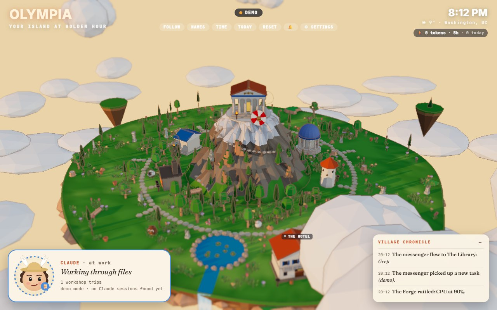

#  Olympia



A living 3D island of your Claude Code work, inspired by u/kanzie's "Nexus Village"
([Reddit post](https://www.reddit.com/r/hermesagent/comments/1x0ra7j/i_gave_my_hermes_setup_a_face/)).
Olympia is a fan project. It is not made by, affiliated with or endorsed by Anthropic.

Olympia is a floating island with Mount Olympus in the middle. **The messenger** lives in the Acropolis on
the peak and flies to a different workshop for each kind of tool your busiest Claude session is using. The
rest of the island mirrors this PC:

| On the island | What it really is |
|---|---|
| The messenger (winged hat and sandals, state ring at its feet) | Whichever Claude Code session is busy: thinking, using tools, replying |
| The Acropolis on the summit | Home of the messenger and of the threads working on Olympia itself |
| Hephaestus' Forge / Library / Beacon / Mnemosyne's Archive / Aviary | Tool destinations: terminal, files, web, memory, messaging |
| Buildings on the outer ring | Your projects: each folder in your projects folder (`projectsRoot` in the config) |
| Lit braziers and chimney smoke | A project with files changing right now |
| Fireworks | A new git commit in that project |
| Felt animals (owl, ram, tortoise, rooster) | Your Claude Code sessions and threads on this PC. Each lives at its project's building, walks to the workshop for what it's doing (Forge for commands, Library for files...), waves with a red "!" when it needs you, and goes inside after a day with nothing to do. Hover one for its name tag |
| Small roosters | Helper agents, trailing the thread that started them; they leave when they finish |
| The Hotel | Threads working outside your projects folder stay here as tourists and check out after two quiet days |
| Market stalls in the Agora | Docker containers (when Docker is running) |
| Parachuted crate | A session getting back to work / a new task |
| The Forge shaking | CPU stuck above 90% |
| Sky, sun, moon and stars | The real sun, moon and moon phase over the place in your config |

The face panel in the bottom-left corner reads **CLAUDE**: how many projects are being worked on, how many
threads are open, and what is running right now. Click it to make the camera follow the messenger.

### Needs you
When a session is waiting on a permission prompt, a question or a plan to approve, its character waves with
a red "!", a red strip at the top lists it ("2 threads need you"), and the tab title shows the count. Click a
name to fly to it; **Open** goes to the session on claude.ai. A tool that hasn't come back in 10 minutes
shows in amber as "may be stuck". The bell turns on desktop notifications. This comes from the live status
files Claude Code keeps in `~/.claude/sessions`, with the transcript as a fallback.

### Details, recap and usage
- **Click a character** for its checklist, the last thing it said, its recent steps and the files it changed.
- **Click the Acropolis** (or **Today**, key **D**) for the daily recap: per place, each thread's finished
  checklist items, files changed and commits. Arrows step back through the last week. Each project's card
  shows its own part of the day.
- **The usage meter** under the clock shows tokens used by sessions on this PC in the last 5 hours and today
  (click for a week by model). Your plan's percent isn't stored on this PC. To show it, set
  `tools/statusline-usage.mjs` as your Claude Code status line (see the comment at the top of that file);
  the meter then shows the 5-hour and weekly bars.

### On your phone
`/list.html` is a light list view (needs you, working now, today, waiting) that also suits a phone; on
small screens the island itself switches to a phone layout. To reach Olympia from your phone on the same
Wi-Fi, set `"lan": true` in `olympia.config.json` and restart: Olympia then listens on your network
(Windows asks once to allow it through the firewall) and prints its address and a 6-digit code. Open the
address on the phone and type the code once; after that a cookie lets the phone in. Five wrong codes lock a
device out for 10 minutes, and 20 in an hour stop pairing for an hour. Delete `olympia.key` and
`olympia.code` to unpair every device and get a new code. If you'd rather skip the code, set
`"lanCode": false`: any device on your network (guests too) can then open Olympia without pairing. The desktop
widget does all of this from its Phone button and tray menu ("Phones need a code" is on by default).

### Sleep the PC from your phone
Off by default. Turn on **Allow Sleep from phone** in the island's ⚙ Settings (Phone section, on the PC
itself), or set `"allowSleep": true`. `/list.html` then shows a **Sleep PC** button: confirm, and the PC
sleeps after a 10-second countdown you can cancel from any device. A phone must have paired with the code
even when `"lanCode": false` lets it open the page, so a guest on your Wi-Fi can't put the PC to sleep.
Requests must come from Olympia's own page (JSON, same origin), at most one every 30 seconds, and each one
is written to `olympia.power.log`. It uses real sleep, never hibernate: on Windows
`SetSuspendState('Suspend')` through PowerShell, on macOS `pmset sleepnow`, on Linux `systemctl suspend`.
`"powerDryRun": true` (or `OLYMPIA_POWER_DRY_RUN=1`) logs the command instead of running it.

The Settings panel also shows what you need to **wake** the PC again with Wake-on-LAN: the network adapter,
whether it's wired or Wi-Fi, its MAC, LAN IP and broadcast address, and (on Windows) read-only checks that
"Wake on Magic Packet" is on and Windows lets the adapter wake the PC. Olympia never changes these settings.
The MAC is shown only on the PC or to a paired phone. PCs on Wi-Fi usually can't be woken this way.

## Desktop widget

Olympia also runs as a small frameless window with a tray icon, so you don't need a browser or Node.
Download either build from the releases page:

- **Portable zip** (`Olympia-<version>-portable-x64.zip`): unzip anywhere and run `Olympia.exe`. Nothing is
  installed; settings live in the `data` folder next to it, so the folder can move between PCs.
- **Installer** (`Olympia-Setup-<version>.exe`): adds a Start menu entry and an uninstaller; settings live
  in `%APPDATA%\Olympia`.

Move the pointer to the top edge to show the title bar: drag it to move, **On top** keeps the widget above
other windows, **Phone** shows the address and code for pairing a phone over home Wi-Fi. Closing hides it to the tray; the tray
menu has phone access, start with Windows, the settings folder, and Quit. On first run the widget writes
`olympia.config.json` from `olympia.config.example.json`, guessing your projects folder.
If `npm run start` is already serving the island, the widget shows that one instead of starting its own.

From source: `npm install`, then `npm run desktop`. To build both downloads: `npm run dist` (output in
`dist/`). The builds aren't code-signed, so Windows SmartScreen asks once before the first run.

## Run it

```
start-olympia.cmd
```

or `npm install` once, then `npm run start`, and open http://localhost:3110.
Olympia uses its own port block, 3110-3114: the island runs on 3110 (`PORT` or `OLYMPIA_PORT` overrides
`"port"` in the config) and the tests use 3111.

Controls: drag to orbit, scroll to zoom, click any building or character for details.
Keys: **F** follow the messenger, **L** name plates, **T** time-lapse the sky, **R** reset view,
**N** fly to the next thread that needs you, **D** today's recap.
Add `?hour=21.5` to the URL to preview a time of day, `?theme=village` for the cozy village look (or set `"theme"` in the config), or `?demo=1` to force demo mode.

## Live from Claude Code

The server reads `~/.claude/projects` (the transcripts every local Claude Code session writes, including
Code-tab sessions and project threads that run on this PC through Remote Control) and `~/.claude/sessions`
(each open session's live status). The live stream carries only metadata: which folder a session started in,
its title, whether it is working or waiting for you, and the tool it is using. A character's card (fetched
only when you click it) adds its checklist, recent step labels, file names and a clipped last reply;
`claudeDetails: false` leaves out the words.
Options in `olympia.config.json`: `claudeDays` (default 7), `claudeMaxCharacters`
(24), `claudeTitlesFromPrompts` (true; set false to show "Session abc123" instead of the first prompt), `claudeProjectsDir`.
`claudeDetails` (true) adds a short label for each session's current step (a command's one-line description,
a file name, a search, a site); set false to show only the kind of tool.

Until a Claude session shows up, the island runs a clearly labelled **DEMO** (amber pill).
Not visible from here: claude.ai chats and cloud sessions, since they leave nothing on this PC.

Olympia only answers requests addressed to `localhost`/`127.0.0.1`, or, with `"lan": true`, to a
home-network address or this PC's name from a paired device (any device there, with `"lanCode": false`).

## Personalize

Everything personal is in `olympia.config.json`: your name and tagline, location (for the sky),
which folder to scan for projects, which to skip, and each project's label and building style
(`tholos`, `stoa`, `studio`, `tower`, `house`).

Try the effects by hand:

```
curl -X POST localhost:3110/api/test -H "content-type: application/json" -d "{\"type\":\"project:commit\",\"project\":\"my-project\",\"subject\":\"Hello from curl\"}"
curl -X POST localhost:3110/api/test -H "content-type: application/json" -d "{\"type\":\"task\",\"name\":\"Water the olives\"}"
```

## Tests

```
npm test
```

Automated tests: `tests/logic.test.mjs` checks that the island reflects reality (sessions to characters,
folders to buildings, working/idle/waiting/sleeping, needs-you, tourists, who is out on the island, tool
routing, card details, the daily recap, token counting, renames, helper agents, sunrise/sunset and moon phase
for a fixed place) against a throwaway fake `~/.claude`; `tests/server.test.mjs` starts a real server on port
3111 (and one with phone access on a free port in 3112-3114) and throws bad input at it.

## How it's built

- `server.js`: zero-dependency Node server. Serves the page and streams state over Server-Sent Events.
- `lib/claude.js`: reads Claude Code session metadata. `lib/live.js`: live status and "needs you".
  `lib/details.js`: a character's card. `lib/ledger.js`: an incremental per-reply ledger for the recap
  and token counts. `lib/usage.js`: the usage meter. `lib/lan.js`: phone pairing.
  `lib/collectors.js`: read-only collectors for CPU/memory, git status and file activity, and Docker.
- `public/js/cast.js`: who is out on the island and where they go (no three.js, tested).
- `public/js`: three.js scene (buildings, the messenger and the residents are generated in code).
- `public/assets`: the island + mountain mesh and the prop pack, both built in Blender, plus the sky HDRI.
  Rebuild them with Blender 5.2:
  `blender -b --factory-startup --python assets-src/build_island.py` and `... assets-src/build_props.py`.
  The island script ports the same edge noise and mountain profile as `world.js`, so placements line up;
  it bakes ambient occlusion into the vertex colours. The props script recolours Kenney's foliage toward
  Mediterranean greens and bakes each model into one vertex-coloured mesh for instancing.
  Asset credits are in `CREDITS.md`. If the assets fail to load, the island falls back to the code-built version.
